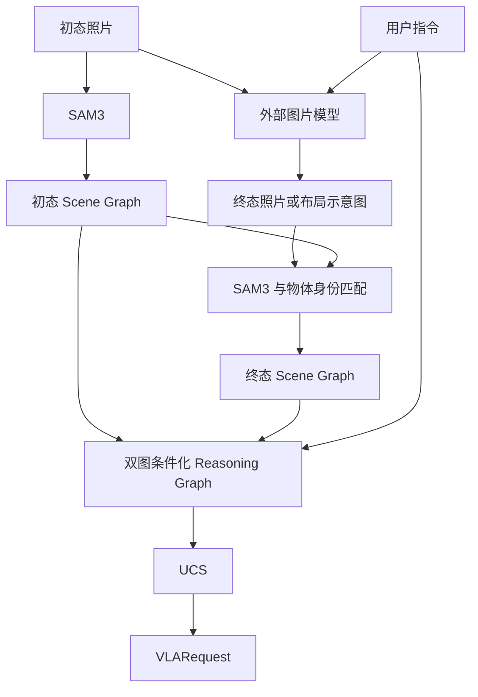

# 当前架构：Image-first 双图条件化规划

详细入口、配置与边界见 [运行说明](high_level_planner/README.md)。

`goal_generator/` 仅 image-first，不再读取规则文件或生成目标关系候选。
`reasoning_graph/target_conditioned.py` 将终态位置、朝向、关节状态与关系转换为可检查目标，
每轮请求同时提供初态图、终态图和当前图。动作合法性检查与本地状态转移保留。

`planner/planner.py:plan_initial_image` 为新的静态集成入口。
`process_observation`、场景图更新信号、`update_reasoning_graph`、增量修复、
GraphMemory 和执行游标逻辑未重写。静态新入口与原动态路径明确分离。

旧 graph-first/physical Goal Generator、规则布局求解、旧终态模型生成入口已删除。
历史输出目录不作迁移；旧脚本参数请按运行说明更新。
