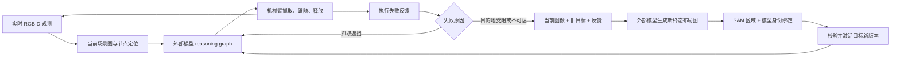

# Scene 003：RGB-D 闭环验证（2026-10-06 至 10-07）

本轮约束：外部 KIMI 模型生成 reasoning graph 动作，执行器根据实时相机观测执行；不读取物品仿真真实位姿、真实尺寸、资产名称映射或实例分割标签；保留双视角完整执行视频，不推送远程。

## 最新完整运行结果

`planner_outputs/scene003_rgbd_graph_20261007_v25` 已自然结束为 **`symbolic_grasp_visually_verified`**。10 次动作均由外部 KIMI 模型提出，使用本轮实时 RGB-D 执行；最终新观测重新验收的 30 项检查全部通过，8 个物品身份均确认。局部节点匹配有 9/10 次命中预期节点；最后手机微调仍被近似匹配为 S0，而完整目标验收已通过，因此以独立的整幅新观测验收作为终态依据，不宣称所有局部节点定位都完全无歧义。最大归一化图像中心误差约 0.00517，可观测无向主轴最大误差约 1.17°。这是布局位置、可观测朝向、承托和关系验收，不是逐像素图像一致性。

该成功轮通过“杯子中转 → 搬书清障 → 文件夹摆放 → 书叠放 → 其余摆放 → 手机角度微调”完成初始目标，**未触发目标修订（版本 0）**。因此不能把这轮说成“改图后的完整成功”；真实失败触发新图、激活新图并执行新动作的链路由 v16–v24 的诊断轮验证，其中发现的区域绑定、身份和反馈问题均按下文修复。新图的最后一次身份裁剪修正另经 v24 同图外部复读验证。尚未取得包含该最后修正在内、实际激活修订目标后整轮成功的运行证据。

- [完整头部相机视频](../planner_outputs/scene003_rgbd_graph_20261007_v25/operation_head_camera.mp4)
- [完整前部相机视频](../planner_outputs/scene003_rgbd_graph_20261007_v25/operation_front_camera.mp4)
- [最终相机图](../planner_outputs/scene003_rgbd_graph_20261007_v25/observation_010_011.png)
- [视觉验收与逐物品误差](../planner_outputs/scene003_rgbd_graph_20261007_v25/final_validation.json)
- [执行轨迹](../planner_outputs/scene003_rgbd_graph_20261007_v25/dynamic_trace.json)
- [视频完整性检查](../planner_outputs/scene003_rgbd_graph_20261007_v25/video_validation.json)

双路各 7,431 帧、640×480、25 fps、297.24 秒；ffprobe 与 ffmpeg 全片解码均通过。视频记录所有模拟控制动作；模型等待时间不按真实墙钟时长加入视频。所有视频留在本地，未推送远程。真值接口拦截审计 `blocked_reads=[]`，高层和动作几何使用视觉/深度及机器人关节反馈；实际接触后的理想速度跟随边界见下节。

## 动态终态修订（用户新增要求）

终态图作为可修订的目标版本管理。`script/adaptive_goal.py` 在目标被占用、目的地受阻、轨迹避碰拒绝或运动失败后，读取本次动作之后的相机图和场景图，把当前节点、失败动作、阻挡物 ID、前一版终态图交给外部模型。模型先生成新的终态布局图，再由图像读取接口提取目标场景图；随后 `HighLevelPlanner.revise_terminal_target()` 以当前观测为起点生成新的 reasoning graph。

KIMI 图像接口输出 SVG 布局插图并渲染为 PNG，不是照片生成。重新读取目标时额外运行 SAM，模型将每个物品 ID 绑定到编号检测区域，坐标取该区域的像素中心；重复区域和无效绑定被拒绝。旋转测量复用同一区域绑定，不根据错误坐标重新猜测身份。修订时同时发送当前相机图与上一版目标图，画布、视角和物品身份保持一致；不从历史成功结果读取坐标。初次通过 `--goal-image` 指定已有图片，不会禁止后续重新生成图片。

修订仍要求保留物品及原有承托/包含关系，提示模型尽量保留已完成摆放。候选身份不完整、丢失物品、改变承托意图、未实质改变目标或新图规划失败时，保留原有效目标并记录拒绝原因。普通抓取遮挡先修订动作顺序；若阻挡物已在其终态位置仍妨碍操作，则判定为终态布局冲突。失败的是临时缓冲位置时，只修订动作路径，不改终态；取物前接近/接触阶段的运动失败也只修复执行，不修改终态。持物未恢复时禁止切换目标。单轮最多激活三版修订目标，并限制最多九次候选生成；拒绝的候选不占用激活版本额度。若一次修订后仍由同一未移动的物品阻挡同一操作，则保留新版目标、先重排清障动作；阻挡物位置确实改变后才允许再次修订。

每次修订保存在 `goal_revisions/revision_NNN/`：当前场景、失败摘要、旧目标、新图片对应的生成审计、候选/激活目标及新 reasoning graph。所有目标朝向都相对本轮最初相机图测量，避免修订后旋转基准漂移。成功只由执行后的新观测相对于**当前激活版本**验收，不能把生成目标图当成执行成功证据。

最终代码的高层完整测试集 **305 项通过**（日志已复制到成功轮 `validation_tests/`）；此前 208 项执行与规划联合回归、后续 19 项身份反馈和 16 项目标读取定向测试也通过（这些集合重叠，不相加），覆盖目标切换原子性、执行证据保留、旋转基准换算、区域绑定及原有 RGB-D 执行流程。v16 已验证“真实失败 → 新终态图 → 新 reasoning graph → 执行新动作”，随后发现新图读取的横向坐标缩放错误并停止诊断。新增 SAM 区域绑定后，v17 又定位到物品旋转后的类别漂移问题，v18 验证了新版订书机摆放和杯子中转，但发现投影近方形被错误视为 90° 对称；最新完整成功轮为 `planner_outputs/scene003_rgbd_graph_20261007_v25`，结果和证据见本文开头。

## 传感器与执行边界

现有 head/front 相机均实测有 640×480 深度输出。默认 `depth: false` 只控制观测字典的打包，并不表示相机没有深度。本轮使用头部相机 RGB、SAM 实例掩码、现有深度和相机标定；机械臂采用关节反馈与机器人运动学模型。未开启腕部相机。

新增 `--visual-only-execution` 路径，不调用旧适配器的物品绑定、位姿快照或仿真成功判定。场景初始化后封锁 `task.objects`、`object_geometry`、`OBJECT_SPECS`、初始/目标底面高度、`_table_z()` 和 `check_success()`。运行记录为 `truth_access_audit.json`。此拦截覆盖列出的接口，不等同于对整个物理引擎的形式化证明。

符号跟随保留了真实关节运动和夹爪闭合。只有指尖出现物理接触后，才能选择接触到的刚体；没有按语义名称查找仿真物品。跟随阶段施加与实际指尖运动一致的线速度和绕竖直轴角速度，物理引擎积分位置；不读取或直接设置物品位姿。放开后停止跟随。这是理想夹持验证，暂不证明摩擦夹持、载荷碰撞及释放后的稳定性；搬运时关闭被抓刚体的碰撞响应，释放后以运动学状态保持当前位置。

## 已修复的问题

1. **二维定位无法给出正确高度**：从相机深度反投影，估计水平桌面、可见物品表面、抓取点和支撑高度，替代真实几何查询。桌面高度由深度估计，未写死场景坐标。
2. **抓取动作与真实接触脱节**：最初在物体上表面略上方闭合，未产生接触；改为按观测高度进行有限深度接近，未接触则拒绝跟随。
3. **背景误检测中断标签校正**：使用深度排除明显低于桌面的检测，目标图片没有深度时不套用此过滤。
4. **遮挡导致整个初始规划停止**：部分可见不等于身份不确定；仍不确定的标签保留为待确认，禁止执行其抓取，但允许先移动遮挡物。可见掩码面积明显增加时重新校正，未变化的帧沿用历史视觉身份。
5. **重叠被误当作阻挡，或上下方向丢失**：场景图根据深度表面高低、投影重合和垂直间距推断 `on`。实测识别出杯子在书上、书在文件夹上，不再只给模型无方向的 bbox 重叠。
6. **机械臂遮挡订书机**：空夹爪先保持当前方向抬起，再向外避让，位置由机器人当前状态和安全间距计算。此前直接转成下抓方向避让会出现跟踪偏差；修正后两臂到位误差均约 3 mm，订书机进入初始检测并由外部模型校正标签。
7. **圆柱物体的图像长轴被当成平面旋转**：使用深度形状判断图像主轴是否适合测量桌面 yaw，避免把高而近圆的物体投影变化当作真实旋转。
8. **空抓失败仍挡着视野**：失败后尝试张开、抬起和撤回，再拍摄用于高层重规划的观测。失败不回滚物品位姿。
9. **执行模式和视觉角度在重规划时丢失**：同一版本的场景通知覆盖了执行器刚补充的视觉角度与验证模式，重新启用了仅凭二维包围框判断占用的约束。生成器现在仅用更新版本替换输入，同版本保留明确传入的观测。
10. **动作位置正确但旋转错误仍被接受**：节点定位现在同时检查位置和角度；目标角度由初始图与目标图的 SAM 掩码比较获得。几何关联允许原始 SAM 标签变化；主轴采用 180° 周期，极近方形轮廓用视觉旋转先验消除主/次轴互换，避免丢失应执行的 90° 旋转。
11. **闭合夹爪先推走物品**：理想夹持模式在抓取前保持静止物品为运动学刚体，保留接触检测；真实闭合且接触到视觉源物体后才启用跟随。旋转探针中请求 10°，视觉测量 8.95°。
12. **抓取点不等于最高表面，导致释放高度漂移**：释放高度按当前接触点与源/目标支撑高度差计算，并补偿实际指尖接触偏移。宽薄物品在名义抓取点之前接触时，允许真实接触作为抓取条件，但不放宽其他路径跟踪误差检查。
13. **显示器旁垂直下降受阻**：从当前深度拟合附近竖直平面，沿平面法向计算倾斜工具轴和插入路径。不使用显示器真实尺寸或预设场景坐标。修正有限平面边缘导致的斜向估计后，杯子探针放置位置误差为 0.00150（归一化图像坐标）。
14. **一次失败禁止物品的所有后续移动**：目的地受阻只抑制相同动作和目的地；不同临时位置仍可由外部模型提出。源位置或阻挡物已改变时允许重新检查，避免 reasoning graph 被历史失败过度剪枝。
15. **支撑物被误当成上层遮挡物**：可见性使用当前深度中真正高于物品的观测点判断。书放在文件夹上不会因为二维包围框相交而被判为“被文件夹遮挡”。文件夹作为目标支撑仍允许部分可见。
16. **静态物品开始跟随时仿真原生崩溃**：v9 在文件夹附着后发生段错误。移除运行时拆换刚体并复用碰撞形状的实现；仅在此模式的场景初始化阶段，将静态资产创建为运动学动态刚体，抓取后才切换为速度跟随。该工厂选项不依赖标签或固定位置；桌面创建不受影响。未正确初始化的静态接触现在返回明确错误，不再尝试危险转换。独立原生物理测试完成 100 次步进。
17. **新观测缺少规划上下文，终态验收漏掉位置/角度**：`TargetGraphEvaluator.evaluate()` 过去依赖调用方事先 `prepare()`，在纯感知更新图上可能只检查关系和可见性。现在每次在观测副本中加载固定目标的全部谓词，再验收位置、可观测角度、支撑和关系；不修改输入。新增未调用 prepare 的位置/角度错误回归用例。
18. **不可观测朝向导致无效动作循环**：深度与轮廓判断为近圆且无法测量平面 yaw 的物品，不再保留图像模型猜测的绝对角度约束。其位置、支撑和可见性仍照常检查；审计记录注明 `rgbd_shape_has_no_observable_planar_yaw`。这不代表已经测得或证明该物品的绝对朝向。
19. **叠放后产生冲突关系和假遮挡**：视觉类别规则同时生成“书在文件夹里面”，深度生成“书在文件夹上面”。有明确可见支撑证据时移除同一对物品的弱包含关系。遮挡检测从桌面 XY 交叠改为相机像素重合加深度高度证据，排除显示器在桌面投影上重叠但未遮挡书的情况。v10 第 8 步观测离线复验后，书为 fully_visible，文件夹为 partially_visible，支撑仅保留 on。
20. **阴影被当成新手机，真实手机丢失原 ID**：外部模型已经指出候选区域是阴影，但旧接口只有 confirmed/uncertain，导致误检仍成为待确认物品。新增高置信度 rejected；相同区域的外观与深度未变时复用拒绝结果，发生变化才重审。移动身份关联排除未确认的同类候选，保留真实物品的一致 ID。回归覆盖“阴影不成为新节点、同一区域出现新物品时再次调用模型”。
21. **目的地仍被占用导致来回搬运**：v14 的订书机目标中心落在尚未移走的文件夹上，图预测为放到桌面，观测却为放到文件夹上。执行前现在用当前 RGB-D 表面范围检查目标中心；若请求的支撑被其他物品覆盖，返回 `destination_occupied` 和视觉阻挡物 ID。高层必须先移走阻挡物；仅挪动源物体不能解除该失败记录。该规则不使用固定坐标，明确指定的目标支撑允许承载物品。节点确认也增加支撑关系一致性检查。

高层仍由外部模型发出具体动作；临时位置来自当前视觉场景的候选区域。未复制成功案例的坐标、缓冲区或动作序列。

## 与 full_v4 成功案例的关系

参考的是“先清除上层遮挡，再处理底层物品；单臂执行；每步观测”的原则。旧案例使用了真实物品几何/位姿、手工动作及放置修正，本轮不复用这些信息。因而旧案例成功不能证明本轮纯传感器流程已经成功，必须以新的闭环记录和视频为准。

## 验证记录

- `scene003_rgbd_probe_20261006_v1`：抓取未接触，正确拒绝附着，保留视频。
- `scene003_rgbd_probe_20261006_v2`：鼠标完成接触、跟随、释放；双路各 556 帧，25 fps。
- `scene003_rgbd_probe_20261006_view_v1`：避让相机视野成功，订书机重新可见，真值接口无违规访问。
- `scene003_rgbd_graph_20261006_v1/v2`：早期初始标签严格阻断，不是完成任务的测试。
- `scene003_rgbd_graph_20261006_v3`：鼠标动作被视觉确认到预期图节点；书的抓取因杯子阻挡而拒绝；外部模型收到反馈后提出先移动杯子。该诊断轮被更新版本替代，不宣称终态成功。
- `scene003_rgbd_graph_20261006_v4`：被保持夹爪方向的新避让实现替代；保留中断原因及视频。
- `scene003_rgbd_graph_20261006_v5`：发现杯子末端下降和旋转验证问题，未达到终态。双路完整视频各 6,137 帧、25 fps。
- `scene003_rgbd_graph_20261006_v6`：定位到同版本场景覆盖导致执行策略丢失；另发现宽薄物体接触早于名义指尖到位。未达到终态。
- `scene003_rgbd_graph_20261006_v7`：初始规划期间被支撑高度与完整目标指令修正替代，无执行成功结论。
- `scene003_rgbd_graph_20261006_v8`：鼠标和键盘动作通过视觉节点校验；杯子插入受阻，机械臂沿关节轨迹返回取物位置后放下；最终 `no_executable_path`。据此修复局部平面法向与失败动作抑制范围。双路各 2,597 帧、25 fps。
- `scene003_rgbd_probe_20261006_cup_insertion_v2`：修正后完成杯子搬运，新 RGB 检测中心 `[0.68550, 0.32297]`，请求 `[0.687, 0.323]`，误差 0.00150。此为执行器探针，不替代完整外部模型测试。
- `scene003_rgbd_graph_20261006_v9`：鼠标、杯子移出、键盘、书本移出四步均通过视觉节点校验；文件夹开始跟随时原生进程退出 139。双路视频经 ffprobe 确认各 3,227 帧、129.08 秒；记录于 `abnormal_exit.json`，不是完成任务的视频。
- `scene003_rgbd_graph_20261006_v10`：文件夹搬运及书本约 80° 旋转叠放均执行成功，并通过视觉节点定位；严格离线验收发现上述终态谓词、不可观测朝向和场景关系问题，不据旧验收器的结果宣称通过。
- `scene003_rgbd_graph_20261006_v11/v12`：初始阶段被上述验收/感知修正替代，保留已有视频，不作为完整测试结论。
- `scene003_rgbd_graph_20261006_v13`：被误检拒绝与手机身份关联修正替代；各中断轮视频的容器检查结果写入 `run_disposition.json`。
- v10 最后一帧使用本轮先前视觉身份重新构图、旋转测量和完整验收后，仅手机角度未通过（目标 -1.74°，观测约 4.97°）。完全不带前帧身份重新识别终态图片则把文件夹误认为第二本书，说明持续视觉身份跟踪仍是必要输入；这不是历史成功动作数据。
- `scene003_rgbd_graph_20261006_v14`：手机身份关联正常；发现订书机在临时位置和被占用的目标之间循环，用于修复上述目的地占用反馈及节点支撑校验。

先前基础回归 **142 项通过**；最新回归数量见上方动态终态修订章节。覆盖 RGB-D 执行、符号跟随、双臂安全、标签校正、节点定位、固定目标验收、反馈重规划和场景更新通知。另有真实相机/物理步进探针与逐轮仿真执行记录；单元测试通过不替代完整运行的终态验收。尚未完成跨多个随机场景的系统性验证，因此不声称已证明所有随机场景都能成功。

终态结论仅采用执行后的新观测验收，不以动作发出或规划图预测 GOAL 作为依据。

- v15：6 次动作请求后，目标代表节点与验证器使用的目标版本不一致导致重规划中止。双路视频各 4,032 帧、161.28 秒。
- v16：第 6 次动作请求发现订书机目的地被文件夹覆盖；新生成目标版本 1 被激活，第 7 次请求执行了新版订书机位置并通过视觉节点校验。随后发现布局读取将横向坐标明显缩小，手机目标进入文件夹区域，执行器再次拒绝。停止诊断后双路视频各 4,677 帧、187.08 秒；未达终态。
- `scene003_goal_revision_replay_20261006_v1`：用 v15 保存的失败观测完成外部模型新图生成、目标读取和新 reasoning graph 构建，生成 3 条边；这是失败观测回放测试，不是仿真执行成功证据。

- v16 新布局图经新的外部模型 + SAM 区域绑定复读，所有 8 个物品均匹配；手机位置由误读 `[0.298, 0.414]` 修正为像素中心 `[0.44854, 0.41800]`，手机旋转由错误关联的 `78.20°` 修正为 `-1.74°`。证据位于 `scene003_rgbd_graph_20261006_v16/grounded_revision_recheck/`，不改变该轮已经执行的历史。

- v17：两版终态图均通过 SAM 区域绑定并激活。第二版订书机动作实际到位，但旋转后被误判为 marker，旧订书机节点滞留，导致视觉校验不通过。失败帧复验的前后外观相似度 0.91836，深度高度相差约 0.4 mm；已知本次搬运与这些测量共同支持恢复原身份，位置误差为 0.00115。该修正不依赖旧标签一致、不读取物品真值，也不把动作指令直接当作位姿观测。双路视频各 3,712 帧、148.48 秒；该轮未达终态。

- v17 订书机旋转复验：当前检测主轴相对本轮初态约 `54.98°`，新版目标约 `56.31°`，差约 `1.33°`。结合到位位置证据，进一步确认这次未通过节点校验主要由身份断裂造成，不能据原含重复节点的观测图宣称整轮完成。

- v18：新版订书机摆放通过视觉节点确认，8 个物品 ID 保持一致。杯子直接转移失败并返回取物处；后续由外部模型规划临时中转，再到达第一版目标，两个动作均通过节点验证。候选版本 2 添加了“手机在书上”的承托关系，被拒绝。该轮随后停止用于修复图像旋转规则和临时缓冲失败的分类，未宣称终态完成。
- 旋转修正：原始投影明显细长的物体，不因目标投影接近方形而采用 90° 对称。统一使用无向主轴的 180° 周期，避免把图中竖放的书编译成横放目标。新增回归明确验证近方形目标仍保留四分之一圈旋转。

- 近乎正方形轮廓的主/次轴可能因像素误差互换：在边长比不超过 1.02 时，用外部图像模型或前帧视觉旋转估计选择轴方向，同时仍使用 180° 周期。v20 初始目标中，书约 80.17°，文件夹约 -8.85°；没有把文件夹轮廓的微小边长差错误变成额外 90° 旋转。

- v20：订书机目的地占用触发并激活目标版本 1；杯子直接转移失败后生成候选版本 2。人工图像检查发现键盘被绑定到显示器底座，候选在激活前中断。新增模型视觉位置与检测框的一致性检查；矛盾绑定反馈模型重读，无法确认则拒绝，避免将错误检测框中心直接作为新目标。此修正及相关 16 项定向测试通过。

- v21：目标版本 1 的杯子、订书机及清障搬书均通过视觉节点确认。文件夹抓取首次选中静态支撑体；第二次实际搬运成功，但检测器把白色内页区域新增为纸张，导致节点验收失败。新增接触筛选排除静态体；取物阶段失败只修复执行，不触发终态改图。新检测校正增加前帧图像、已有身份及运动上下文；外部模型对该失败帧复验后确认文件夹、拒绝重复纸张，证据为 `scene003_rgbd_graph_20261007_v21/nested_region_recheck/`。双路完整诊断视频各 10,214 帧、408.56 秒，本轮不宣称终态通过。
- 性能：候选位置检查读取几何属性时不再反复深拷贝整份视觉描述；只读几何与原规则不变。合并回归 205 项全部通过，耗时 12.695 秒。

- v22：全轮自然结束为 `no_executable_path`，7 次请求，6 次动作通过视觉节点验收。候选终态改变承托关系被正确拒绝；随后生成器仍选中先前被阻挡的订书机动作，直到整图生成后才被禁用，导致后续清障路径不可达。失败目的地及阻挡物视觉位置现提前进入候选动作校验，允许外部模型在分支筛选前改进动作。清理旧任务策略时保留安全的执行证据，避免目标修订时丢失反馈。
- 场景图复制隔离：`SceneGraph.copy()` 原实现共享嵌套 metadata，修改副本的位置会污染原图。现深复制嵌套值；新增测试验证目标改动不改变当前观测，并验证失败阻挡分支不会挤掉可执行清障分支。

- v23：全轮自然结束为 `no_executable_path`，8 次请求；文件夹搬运、书本按原目标旋转叠放均通过视觉节点确认，初始订书机却被低置信度标为 paper clip，执行因未确认身份被拒绝。已新增明确执行拒绝触发的单物品标签重审，普通未变化帧仍不调用外部模型。失败帧外部重审确认 stapler（0.95），证据为 `scene003_rgbd_graph_20261007_v23/identity_failure_recheck/`。标签重审和闭环相关 19 项定向测试通过。高层规划器完整 304 项测试已通过（`/tmp/tablesim_highlevel_v23_verified_tests.log`）；其中一条原有测试改为检验无效区域动作不能产生可执行边/虚假终态，以匹配现有模型修复流程。

- v24：目标版本 1 激活后，新订书机位置仍被未移动的文件夹占用；框架保留新版目标并改为清障，杯子、手机、书搬运均通过节点验证。检查发现新终态读取将重叠的书与文件夹区域互换，故中断。新增带真实视觉 ID/名称的当前物品裁剪、以及带检测编号的目标区域放大图；外部模型对同一目标图复读后，黑书与蓝文件夹正确关联，8 个 ID 完整，证据为 `scene003_rgbd_graph_20261007_v24/target_identity_recheck/`。相关 16 项定向测试通过。双路诊断视频各 7,534 帧、301.36 秒。
