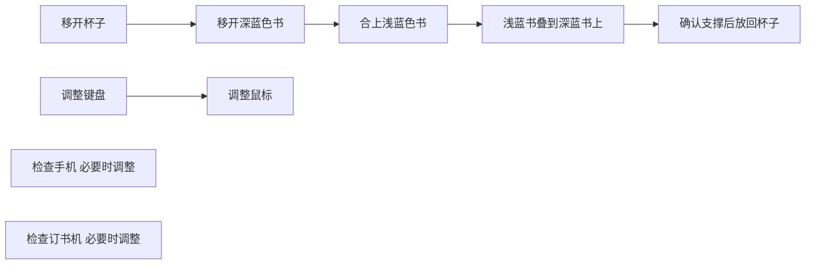

# scene_003：直接读图得到的动作方案

本文件记录可观察依据、动作理由摘要和预期状态变化，不记录私有内部思维链。由当前助手直接分析两张图片，未调用外部模型，未运行旧 reasoning graph，未注入额外 rules。

输入沿用当前流程的初始照片和 kimi 终态布局图；不是此前 astra 的终态照片。

## 物体和可见变化

|物体|初态可见情况|终态要求|置信度|
|---|---|---|---|
|显示器|桌面后部中央，带底座|保留在后部中央|high|
|浅蓝色书|左侧摊开，右侧被深蓝色书和杯子遮挡|合上并位于深蓝色书上方|high|
|深蓝色书|闭合，覆盖浅蓝色书右侧的一部分|位于左侧书堆下层|high|
|花纹杯|直立，投影覆盖深蓝色书；具体接触面被遮挡|直立，位于书堆前右侧；支撑物不确定|medium|
|键盘|显示器前方偏右，长轴明显倾斜|显示器前方，长轴更接近桌沿方向|high|
|鼠标|显示器右前方|键盘右侧且略靠后|high|
|订书机|桌面左前侧，上下部件有间隙|仍在左前侧；示意图不能确定铰链状态变化|medium|
|手机|桌面右前侧|仍在右前侧，屏幕朝上|high|

## 动作依赖

下面是一种串行执行顺序，共 7 个必需动作阶段和 2 个条件检查/调整阶段。阶段不等于机器人原子动作；每一步都以视觉检查通过为前提。

## A01：保持直立，将杯子移至桌面中央偏前的临时空区。

简要依据：先解除杯子对书本操作的遮挡和潜在载荷。

前置条件：识别杯体和可抓取部位；从当前视角确认缓冲区空闲、远离桌沿且不占用书堆目标区。

预期状态：S00 → S01；{"cup": {"location": "temporary_buffer", "support": "table", "pose": "upright"}}。

完成检查：杯子稳定直立；两本书上方不再有杯子。

图像参考：initial 图，归一化中心约 [0.52, 0.76]；桌面中央偏前的空区。仅为区域提示，不是实际放置坐标。

## A02：将深蓝色闭合书从浅蓝色书上移开，放到左侧书堆的下层目标位置。

简要依据：露出浅蓝色书的闭合区域，同时建立终态书堆的底层。

前置条件：杯子已离开书区；搬运路径和落点不与仍摊开的浅蓝色书相交；不满足时先临时移至另一空区，再放到目标位。

预期状态：S01 → S02；{"book_dark_blue": {"location": "left_stack_base", "support": "table", "articulation": "closed"}}。

完成检查：浅蓝色书的闭合区域无压载；深蓝色书平放且目标区域可供叠书。

图像参考：terminal 图，归一化中心约 [0.347, 0.653]；左侧书堆下层。仅为区域提示，不是实际放置坐标。

## A03：在桌面支撑下合上浅蓝色书。

简要依据：初始图书页摊开，终态图显示浅蓝色封面和闭合书体。

前置条件：书面和书页运动区域无杯子及深蓝色书；具备可控制书脊及书页的闭合能力。

预期状态：S02 → S03；{"book_light_blue": {"location": "left_work_area", "support": "table", "articulation": "closed"}}。

完成检查：两侧书页合拢；封面朝上且书体没有压住其他物体。

## A04：将闭合的浅蓝色书放到深蓝色书上，按目标图大致对齐书堆方向。

简要依据：终态明确呈现深蓝色在下、浅蓝色在上的叠放关系。

前置条件：下层深蓝色书已就位；根据当前视觉确认上层书获得稳定支撑。

预期状态：S03 → S04；{"book_light_blue": {"location": "left_stack_top", "support": "book_dark_blue", "articulation": "closed"}}。

完成检查：浅蓝色书位于深蓝色书上方；两书闭合，书堆稳定；杯子的候选落点未被完全遮住。

图像参考：terminal 图，归一化中心约 [0.361, 0.617]；深蓝色书上方。仅为区域提示，不是实际放置坐标。

## A05：核实书堆前右侧的支撑面，再将杯子从临时区移到该目标区域并保持直立。

简要依据：终态要求杯子位于书堆前右侧，但示意图不能唯一确定它放在哪一层上。

前置条件：书堆稳定；已通过当前视觉确认杯子落点及支撑面；若不能确认则保持在缓冲区，不执行放置；落点不会妨碍书堆稳定。

预期状态：S04 → S05；{"cup": {"location": "stack_front_right", "support": "visually_confirmed_at_execution", "pose": "upright"}}。

完成检查：杯子直立且释放后稳定；相对书堆的前右位置符合目标；记录实际支撑物，不能仅凭投影重叠判定 on。

图像参考：terminal 图，归一化中心约 [0.391, 0.628]；书堆前右侧。仅为区域提示，不是实际放置坐标。

## A06：将键盘调整至显示器前方，长轴方向与目标图中的桌面横向大致一致。

简要依据：键盘是始末图中朝向变化最明显的独立桌面物体。

前置条件：键盘落点空闲；调整不碰到杯子缓冲区和书堆。

预期状态：S05 → S06；{"keyboard": {"location": "in_front_of_monitor", "support": "table", "orientation": "approximately_along_desk_width"}}。

完成检查：位于显示器前方；长轴接近目标朝向，未遮挡其他物体。

图像参考：terminal 图，归一化中心约 [0.606, 0.638]；显示器前方。仅为区域提示，不是实际放置坐标。

## A07：将鼠标对齐到键盘右侧略靠后的位置。

简要依据：以键盘为参照能避免把绘图中的桌面整体变形误当成鼠标位移。

前置条件：键盘位置已确定；键盘右侧空闲。

预期状态：S06 → S07；{"mouse": {"location": "right_and_slightly_behind_keyboard", "support": "table"}}。

完成检查：鼠标在键盘右侧并留有可见间隔。

图像参考：terminal 图，归一化中心约 [0.723, 0.603]；键盘右侧略靠后。仅为区域提示，不是实际放置坐标。

## A08：检查手机相对桌沿的位置与朝向；确有偏差时调整，保持屏幕朝上。

简要依据：两图中手机都处于右前侧，不能仅凭像素差认定必须移动。

前置条件：通过桌沿和物体相对位置比较，排除绘图风格造成的表观位移。

预期状态：S07 → S08；{"phone": {"location": "front_right", "support": "table", "pose": "screen_up", "goal_region_checked": true}}。

完成检查：仍在桌面右前侧；屏幕朝上，不要求改变屏幕内容。

条件分支：仅当相对桌沿的位置或朝向不符合目标时移动，否则检查通过后跳过移动。

图像参考：terminal 图，归一化中心约 [0.718, 0.84]；桌面右前侧。仅为区域提示，不是实际放置坐标。

## A09：检查订书机在左前侧的摆放，仅在需要时调整位置或平面朝向。

简要依据：终态图不能可靠证明需要合上订书机，因此不增加开合动作。

前置条件：已区分摆放差异与绘图外观差异。

预期状态：S08 → S09；{"stapler": {"location": "front_left", "support": "table", "articulation": "unresolved_unchanged", "goal_region_checked": true}}。

完成检查：仍在桌面左前侧；不根据简化轮廓强行改变铰链状态。

条件分支：仅当桌面相对位置或朝向不符合目标时移动，否则检查通过后跳过移动。

图像参考：terminal 图，归一化中心约 [0.166, 0.77]；桌面左前侧。仅为区域提示，不是实际放置坐标。

## 不确定性与处理

- **U1 终态杯子的支撑面**：杯底接近深蓝色下层书前缘，且遮住浅蓝色上层书的边缘；二维绘图不能唯一确定接触关系。 主候选为下层深蓝色书前右侧露出的区域，但不把它写成已确认的 on 关系。A05 先用当前视觉确认接触区域和承载稳定性；无法确认时暂停该放置动作。
- **U2 跨图坐标不可直接作为位移**：终态是简化布局图，桌沿、显示器比例及视角与初始照片不同。 图像坐标仅用于定位区域；在线利用桌沿与物体相对位置进行视觉对准，不直接计算像素差作为机器人位移。
- **U3 订书机的开合状态**：始末图均有上下部件分离的外观，绘制风格不同。 不指定 close_stapler；仅在相对位置或朝向不符时调整摆放。
- **U4 书堆和杯子的实际稳定性**：绘图显示浅蓝色书横跨深蓝色书，无法得出真实尺寸、质心或摩擦系数。 放置前根据可见接触区域选点，释放前确认支撑并在释放后复查；本计划不宣称已验证物理可执行性。
- **U5 手机和订书机是否需要移动**：两者保持同一桌面分区，像素变化可能来自图像重绘。 A08、A09 是条件动作：桌面相对位置与目标一致时跳过。

## 终态验收

- 八件物体均保留，显示器未移动。
- 浅蓝色书闭合并位于深蓝色书上。
- 杯子直立、位于书堆前右侧且实际支撑已确认。
- 键盘位于显示器前方并调整朝向，鼠标位于其右侧。
- 手机在右前、订书机在左前；忽略绘图风格差异。
- 缓冲区已清空，各物体均在桌面支持范围内。

## 验证范围

JSON 附有 S00–S09 的完整符号状态快照。快照是满足动作前置条件时的预测，不是仿真或执行观察。verify_plan.py 检查文件一致性、物体引用、动作依赖顺序和状态更新；不验证图像识别正确率或物理可行性。

- 始末图只能支持一种合理的候选动作流程，不能证明真实发生过该过程或其步数最优。
- 没有进行物理执行、碰撞检测、抓取可达性验证或真实尺度标定。
- 在 A05 支撑面未确认前，不能声称获得唯一且物理有效的完整终态支撑图。
